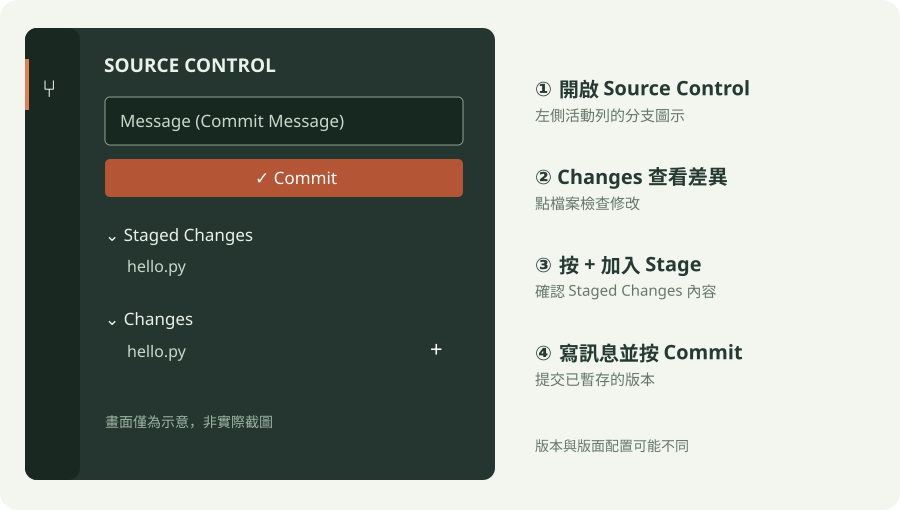

# VS Code Source Control 入門

這是第一次接觸 Git 的起點。完成後，你會用 VS Code 記錄一個範例的版本，並知道如何查看下一次修改。建議在完成第一個程式範例後，花 20～30 分鐘跟著操作。

## 開始之前

先完成[環境安裝與設定](../環境安裝與設定/README.md)，確認已安裝 Git、VS Code，並設定 Git 的姓名與電子郵件。使用 VS Code 的 **File → Open Folder** 開啟一個專門練習的資料夾；不要在已經由其他 Repository 管理的資料夾內再初始化。若是自己的課程專案，先確認專案資料夾是否已經有 Git，已有 Repository 就不必再次初始化。

VS Code 的英文介面與版本可能略有不同；找不到功能時，可開啟 Command Palette，搜尋這裡列出的命令名稱。

想先對照實際畫面，可以查看下方 VS Code 官方文件的截圖。圖片需要連線；文件檢視日期為 2026-11-05，實際介面可能隨 VS Code 更新改變。離線時可使用後面的示意圖。

**初始化：** Source Control 中的 **Initialize Repository**。來源：[VS Code 官方入門文件](https://code.visualstudio.com/docs/sourcecontrol/quickstart)。

**暫存：** 在 Changes 清單的檔案旁選擇 **+**。來源：[VS Code 官方 Stage 與 Commit 文件](https://code.visualstudio.com/docs/sourcecontrol/staging-commits)。

**如何判斷是否已有 Repository？** 開啟資料夾後選 **Source Control**：若顯示目前的 Repository 與變更清單，不需 Initialize。若不確定是否被上層資料夾管理，在 VS Code Terminal 執行 `git rev-parse --show-toplevel`：顯示路徑代表目前位置位於該 Repository 內；若顯示 `not a git repository`，目前位置不在 Repository 內。先確認 Terminal 所在位置與顯示的路徑，不要在既有專案內重複初始化。

## 1. 認識四個名稱

| 名稱 | 意思 |
| --- | --- |
| Repository | Git 用來管理專案與版本紀錄的儲存庫 |
| Changes | 相對於目前暫存內容，尚未 Stage 的變更 |
| Stage | 選擇這次 Commit 要記錄的內容 |
| Commit | 將已 Stage 的內容記成一筆附有訊息的版本紀錄 |

## 2. 建立第一筆 Commit

下圖是**操作示意圖，不是 VS Code 截圖**；實際按鈕位置會因版本、視窗大小與設定不同而改變。

[開啟示意圖放大檢視](../docs/assets/source-control-guide.svg)（手機可放大圖片查看）。

1. 開啟左側 **Source Control**。若資料夾尚未使用 Git，選擇 **Initialize Repository**；若已顯示 Repository，跳過此步。
2. 在 Explorer 新增 `hello.py`，寫入 `print("Hello, Git!")` 並儲存。若使用自己的課程範例，改用該範例即可。
3. 執行範例確認結果。回到 **Source Control**，在 **Changes** 點選檔案查看內容或差異。新檔案可能以完整內容顯示。
4. 將滑鼠移到檔案名稱旁，按 **+**（**Stage Changes**），確認檔案出現在 **Staged Changes**。先確認清單，只選擇這次要記錄的檔案。
5. 在訊息欄輸入 `Add hello example`，選擇 **Commit**。若 VS Code 提示設定提交身分，回到環境設定完成後再試。
6. 確認清單中沒有預期要提交而尚未提交的檔案，並在 Source Control 的 **Graph** 或 **Timeline** 查看剛才的 Commit；顯示位置可能因版本或設定不同。

這個 Commit 保存在電腦上的 Repository，尚未自動上傳 GitHub。

## 3. 再做一次修改

把 `hello.py` 改成 `print("Hello, VS Code!")` 並儲存，點選 **Changes** 的檔案查看差異，然後 Stage。接著把它再改成 `print("Hello, Git and VS Code!")` 並儲存。此時同一個檔案可能同時出現在 **Staged Changes** 和 **Changes**：前者是 Stage 當時的內容，後者是後來的修改。點選兩處分別查看；如果希望 Commit 包含最新內容，再把 Changes 中的檔案 Stage 一次，輸入 `Update greeting` 並 Commit。

若找不到變更，先確認檔案已儲存、開啟的是正確資料夾，且修改與目前版本不同。若 Commit 按鈕無法使用，確認已有 Staged Changes、已填訊息及設定提交身分；若 VS Code 顯示錯誤，先閱讀提示再處理，不要刪除 `.git` 資料夾。

## 4. 每個範例完成後

**執行範例 → 查看 Changes → Stage 要記錄的內容 → 寫 Commit Message → Commit**

前幾次由老師帶著操作，之後試著獨立完成。不要只按按鈕：先確認變更的內容和檔案，再提交。虛擬環境、密碼等不應納入版本紀錄；遇到需要排除的檔案時，先看 [`.gitignore`](../不想被追蹤的檔案/README.md)。

完成後做[第一次 Commit 入門檢核](../測驗/README.md#第一次-commit-入門檢核)：確認能找出差異、選擇內容並說明 Commit 的結果。

接下來先在課程範例中練習幾次，再閱讀[第 01 章：工作區與暫存區](../開始使用Git/README.md)，用 VS Code Terminal 深入理解相同流程。
