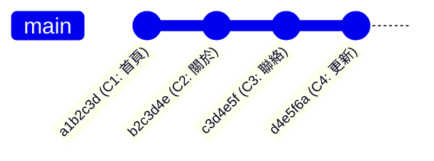
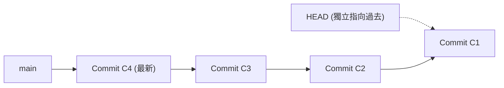
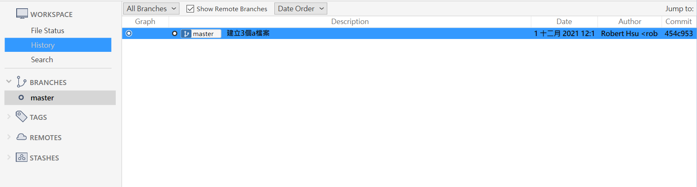

# main、HEAD 與歷史

**建立版本 · 第 02 章**　[學習路線](../README.md) · [互動圖解](../docs/README.md)

在上一章中，我們學會了如何在工作區、暫存區與儲存庫之間提交版本。本章將帶你深入了解 Git 的核心骨幹：**Commit（提交）**、**main（主要分支）** 與 **HEAD（當前指針）** 是如何協同運作的。

---

## 1. 核心觀念：三者的關係

初學者常把分支誤認為是「一個獨立的資料夾」，但實際上在 Git 裡：

```text
  HEAD (你目前所在的位置)
   │
   ▼
  main (分支指標，只記著最新那一筆 commit ID)
   │
   ▼
[ Commit C3 ] ──(指向父提交)──> [ Commit C2 ] ──(指向父提交)──> [ Commit C1 ]
```

| 元素 | 本質 | 比喻 | 說明 |
| :--- | :--- | :--- | :--- |
| **Commit（提交）** | 專案歷史快照 | **里程碑** | 每次提交都會產生一個唯一識別碼（如 `a1b2c3d`），記錄當時的所有檔案狀態、作者、時間與父提交。 |
| **main（分支）** | 指向某個 Commit 的指標 | **書籤** | 預設的主要分支名稱。每次在此分支產生新 Commit，`main` 就會自動前進指向最新 Commit。 |
| **HEAD** | 指向「目前所在位置」的特殊指標 | **「你目前站在這裡」的標記** | 通常指向你當前所在的分支（如 `HEAD -> main`）。如果它直接指向某個 Commit，則稱為 `Detached HEAD`（分離狀態）。 |

> [!NOTE]
> **關於 main 與 master**：  
> 早期的 Git 預設主要分支名為 `master`，現在主流平台（如 GitHub、GitLab）與新版 Git 皆統一改為 `main`。兩者僅是名稱不同，功能完全一致。

---

## 2. 實戰範例：由淺入深理解歷史推進

請開啟終端機或 Git Bash，建立一個乾淨的練習環境：

### 範例 1：建立起點與觀察指標初始狀態

建立專案並提交第一筆版本：

```bash
mkdir history-demo
cd history-demo
git init -b main

# 建立首頁並寫入內容
echo "# 歡迎來到我的個人網站" > index.md
git add index.md
git commit -m "feat: 初始化專案，建立首頁"
```

#### 觀察狀態：
```bash
git log --oneline --decorate
```
預期輸出：
```text
a1b2c3d (HEAD -> main) feat: 初始化專案，建立首頁
```
> **解析**：`HEAD -> main` 表示 `HEAD` 目前正指著 `main` 分支，而 `main` 正指著 Commit `a1b2c3d`。

---

### 範例 2：連續提交與指標自動前進

隨著開發推進，新增更多功能與內容：

```bash
# 第二次提交：新增關於我們
echo "這是關於我的介紹" > about.md
git add about.md
git commit -m "feat: 新增關於我們頁面"

# 第三次提交：新增聯絡方式
echo "聯絡信箱：contact@example.com" > contact.md
git add contact.md
git commit -m "feat: 新增聯絡資訊"

# 第四次提交：更新首頁標題
echo "最新消息：網站即將改版！" >> index.md
git add index.md
git commit -m "docs: 首頁追加最新消息"
```

#### 視覺化歷史線圖：
```bash
git log --oneline --graph --decorate
```
預期輸出：
```text
* d4e5f6a (HEAD -> main) docs: 首頁追加最新消息
* c3d4e5f feat: 新增聯絡資訊
* b2c3d4e feat: 新增關於我們頁面
* a1b2c3d feat: 初始化專案，建立首頁
```


> **核心概念**：每次執行 `git commit` 時，Git 會建立新的提交，並**自動把 `main`（以及指著它的 `HEAD`）往前推一步**。

---

### 範例 3：利用相對參照（`HEAD~`）回溯與比較歷史

你不需要每次都去複製長長的 Commit 雜湊碼，可以使用 `~`（波浪號）來代表「往回倒數第幾筆」：

* `HEAD`：目前最新這筆（C4）
* `HEAD~1` 或 `HEAD^`：前一筆（C3）
* `HEAD~2`：前兩筆（C2）
* `HEAD~3`：前三筆（C1）

#### 1. 查看前一筆（HEAD~1）提交了哪些變更：
```bash
git show HEAD~1
```
> 可以看到當時新增 `contact.md` 的詳細內容差異。

#### 2. 比較現在（HEAD）與最初版本（HEAD~3）的檔案差異：
```bash
# 只看有變動的檔案清單
git diff --name-status HEAD~3 HEAD
```
輸出：
```text
A       about.md
A       contact.md
M       index.md
```
> **解析**：`A` 代表新增（Added），`M` 代表被修改（Modified）。

#### 3. 檢視特定歷史版本的檔案清單（不需切換版本）：
```bash
git ls-tree --name-only HEAD~3
```
輸出：
```text
index.md
```
> 第一版的時候，專案裡確實只有 `index.md`，完全不用切換分支就能調閱歷史資料！

---

### 範例 4：剛提交就後悔？使用 `git commit --amend`

如果剛剛提交完，發現**打錯 commit 訊息**，或是**漏放了一個檔案**，不用建立一筆尷尬的修正 commit，直接就地修改最新一筆！

#### 情境 A：只改上次的 Commit 訊息
```bash
git commit --amend -m "docs: 首頁追加最新改版消息 (修正錯字)"
```

#### 情境 B：補上忘記暫存的檔案進上一筆 Commit
```bash
echo "樣式設定" > style.css
git add style.css

# 使用 --no-edit 表示沿用原本的 commit 訊息
git commit --amend --no-edit
```
> [!WARNING]
> `--amend` 會替換最新一筆 Commit 的身分識別碼（產生新的 SHA-1）。**已推送到遠端（push）的 Commit 請勿隨意 amend**，以免造成團隊成員歷史衝突。

---

### 範例 5：進階探索 —— 什麼是 Detached HEAD（分離頭指針）？

如果我們讓 `HEAD` 不指向分支，而是直接指向某個過去的 Commit，會發生什麼事？

```bash
# 使用 git switch 的 --detach 選項回到第一筆提交
git switch --detach HEAD~3
```
終端機輸出提示：
```text
You are in 'detached HEAD' state...
HEAD is now at a1b2c3d feat: 初始化專案，建立首頁
```
檢視目前資料夾：
```bash
ls
```
> 檔案瞬間回到只剩 `index.md` 的起點狀態！



* **安全返回**：隨時使用 `git switch main`，就能回到現代，檔案也會立刻還原：
```bash
git switch main
```

---

## 3. 分支常用指令速查

| 目的 | 指令 |
| :--- | :--- |
| **新建儲存庫並指定 main** | `git init -b main` |
| **設定日後全域預設分支為 main** | `git config --global init.defaultBranch main` |
| **將目前分支重新命名為 main** | `git branch -m main` |
| **查看目前所在的分支** | `git branch --show-current` |
| **單行精簡顯示歷史線圖** | `git log --oneline --graph --decorate -n 5` |
| **計算歷史提交總次數** | `git rev-list --count HEAD` |

---

## 4. 自己動手做

請在剛才的 `history-demo` 專案中完成以下任務：

1. 新增檔案 `faq.md`，寫入「常見問答」，並建立一筆提交：`feat: 新增常見問答`。
2. 檢查 `git rev-list --count HEAD`，確認提交總數是否增加。
3. 使用 `git show HEAD~1`，確認你看到的是前一次修改的 Commit。
4. 使用 `git commit --amend` 將最新提交的說明改成：`feat: 新增常見問答 (FAQ)`。

完成驗收：`git log --oneline -n 2` 能清楚看到更新後的訊息，且工作目錄保持乾淨。

---

## 5. 圖形介面（GUI）中的歷史長怎樣？

除了終端機指令，各類 Git GUI 工具（如 SourceTree、VS Code Git Graph）也是透過相同的方式將線圖畫出來：



> 圖中的頂端圓點即為當前分支的最新版本，底下的每一行都是一筆歷史 Commit。

---

[← 工作區與暫存區](../開始使用Git/README.md)　｜　[分支與合併 →](../分支/README.md)
