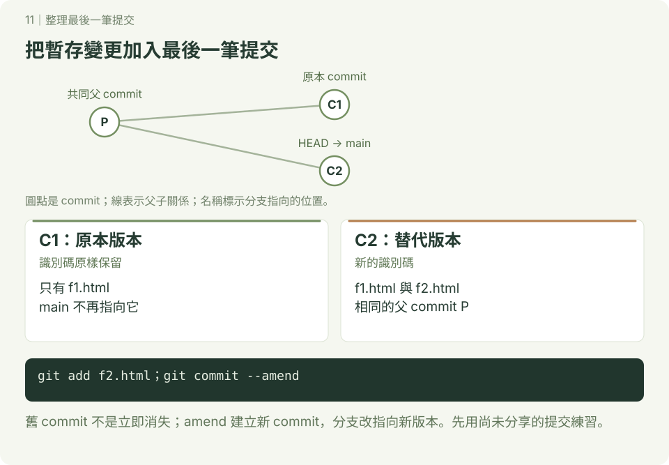
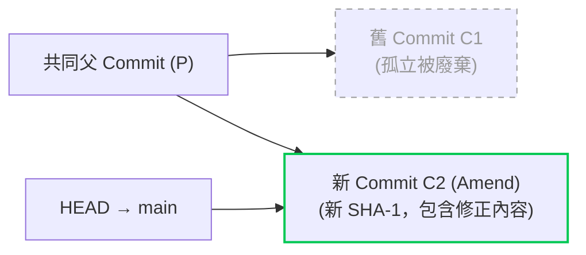
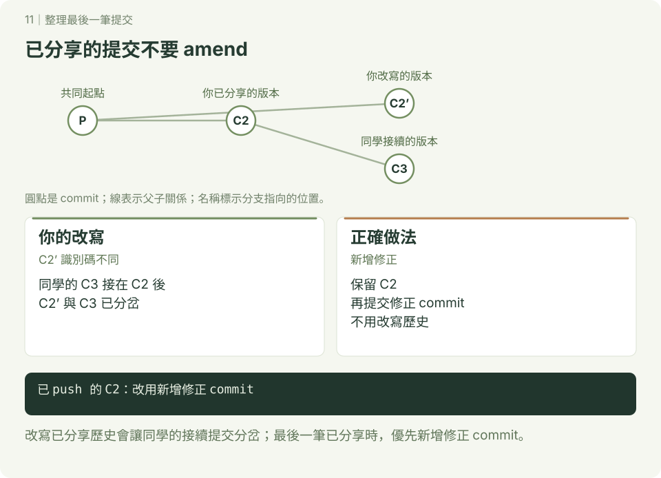

# 整理最後一筆提交 (git commit --amend)

**復原與整理 · 第 11 章**　[學習路線](../README.md) · [互動圖解](../docs/README.md)

在日常開發中，每個人都經歷過這種「手滑」時刻：剛按下提交，才發現**提交訊息打錯字**，或是**最重要的設定檔忘記 `git add`**。

這時候不需要尷尬地再推一筆寫著「fix: 補上剛才漏掉的檔案」或「fix: 修錯字」的 Commit。透過 **`git commit --amend`**，你可以優雅地就地修改最後一筆提交！

---

## 1. 核心觀念：amend 的背後原理

`amend` 在英文中是「修正、修訂」的意思。初學者常以為它是「直接修改舊 Commit 的文字或內容」，但**在 Git 的底層設計中，任何 Commit 一旦生成就不可竄改**。

實際上，Git 執行 `amend` 時做的是：
1. 讀取前一次提交的內容與暫存區的新改動。
2. **建立一個全新的替代 Commit（擁有新的 SHA-1 雜湊碼）**。
3. 將目前分支（如 `main`）與 `HEAD` 指針重新指向這個全新 Commit。
4. 舊的 Commit 失去指標引用，日後會被 Git 垃圾回收機制自動清理。





> [!CAUTION]
> **黃金法則：只對尚未 Push 到遠端的 Commit 進行 amend！**  
> 一旦 Commit 已經推送到 GitHub 或與同事共享的分支，絕對**不要**再對它執行 `amend`。因為改變 Commit 識別碼會導致遠端與隊友的歷史分岔，引發災難性的衝突。

---

## 2. 常用指令速查表

| 目的 | 指令 | 說明 |
| :--- | :--- | :--- |
| **只修改最後一筆訊息** | `git commit --amend -m "新訊息"` | 快速替換上一筆 Commit 訊息 |
| **納入新暫存，但保留原訊息** | `git commit --amend --no-edit` | 加入漏掉的檔案，不更動原本的訊息 |
| **開啟文字編輯器修改訊息** | `git commit --amend` | 開啟預設編輯器（如 VS Code / Vim）細修多行說明 |
| **暫存區有東西但只想改訊息** | `git commit --amend --only -m "新訊息"` | 忽略暫存區的檔案，純粹改文字 |

> [!TIP]
> **VS Code GUI 選單對照**：  
> 若習慣在 VS Code 側邊欄操作，在「原始檔控制」選單中的 **「認可 (修改)」** 或 **「提交暫存 (修改)」**，後方括號的 `(修改)` 就是對應英文的 **`(Amend)`**。

---

## 3. 實戰範例：由淺入深操作

請開啟終端機或 Git Bash，建立一個全新專案來親自驗證：

```bash
mkdir amend-demo
cd amend-demo
git init -b main

# 建立專案起點
printf '# 練習專案\n' > README.md
git add README.md
git commit -m "feat: 建立練習起點"
```

---

### 【簡單】範例 1：純粹修正最後一筆 Commit 訊息

#### 情境：
剛送出一筆提交，但訊息中出現了錯字或臨時想改更專業的寫法。

#### 1. 產生一筆有錯字的提交：
```bash
echo "<h1>首頁</h1>" > index.html
git add index.html
git commit -m "feat: 新增首頁 (訊息打錯字惹)"

# 查看目前最新 Commit
git log --oneline -n 1
```
輸出範例：
```text
a1b2c3d (HEAD -> main) feat: 新增首頁 (訊息打錯字惹)
```
*(請注意這時的識別碼是 `a1b2c3d`)*

#### 2. 使用 amend 修改訊息：
確保暫存區沒有其他干擾內容，直接覆蓋訊息：
```bash
git commit --amend -m "feat: 新增網站首頁"
```

#### 3. 驗證結果：
```bash
git log --oneline -n 2
```
輸出：
```text
f9e8d7c (HEAD -> main) feat: 新增網站首頁
b3c4d5e feat: 建立練習起點
```
* **分析**：
  * Commit 總數維持 2 筆，沒有產生多餘的提交。
  * 訊息已修正，且 Commit ID 從 `a1b2c3d` 變成了全新的 `f9e8d7c`。

---

### 【中等】範例 2：補上漏掉的檔案（保留原本訊息）

#### 情境：
剛剛提交了登入頁面，卻發現漏掉了登入頁專用的 CSS 樣式檔！


#### 1. 提交登入頁：
```bash
echo "<form>登入表單</form>" > login.html
git add login.html
git commit -m "feat: 新增會員登入頁面"
```

#### 2. 發現漏掉樣式檔，將其補進上一筆：
```bash
# 建立忘記加入的樣式檔
echo "body { background: #eee; }" > login.css

# 步驟 A：先將漏掉的檔案加入暫存區
git add login.css

# 步驟 B：使用 --no-edit 將暫存區內容併入上一筆，保留原有說明
git commit --amend --no-edit
```

#### 3. 驗證提交內容：
```bash
git show --stat HEAD
```
輸出：
```text
commit 3a4b5c6 (HEAD -> main)
Author: Your Name <you@example.com>
Date:   ...

    feat: 新增會員登入頁面

 login.css  | 1 +
 login.html | 1 +
 2 files changed, 2 insertions(+)
```
* **分析**：最新一筆 Commit 同時包含了 `login.html` 與 `login.css`，天衣無縫！

---

### 【進階】範例 3：同時修改程式碼內容與提交訊息

如果既要調整檔案內容，又要重新措辭說明：

```bash
# 發現 README 說明不夠詳細，繼續修改
echo "本專案支援會員登入機制" >> README.md
git add README.md

# 同時納入修改並更新訊息
git commit --amend -m "feat: 完成會員登入頁面並更新專案說明"
git log --oneline -n 1
```

---

## 4. 為什麼已 Push 的 Commit 不能 amend？

如果某個 Commit 只存在你的電腦裡，使用 `amend` 整理歷史非常完美。但若這個 Commit 已經推送到遠端（如 GitHub）：



```text
遠端 / 同事電腦： ── [ C1 ] ──> [ C2 (原始版本) ] ──> [ C3 (同事基於 C2 開發) ]
                                      ▲
                                 歷史分岔與衝突！
                                      ▼
你的本地電腦：   ── [ C1 ] ──> [ C2' (你 amend 後的新版本) ]
```

1. 遠端保留著舊的 `C2`，你的電腦卻變成了新的 `C2'`。
2. 下次你執行 `git push` 時，Git 會拒絕推送（報錯：`Updates were rejected because the tip of your current branch is behind`）。
3. 如果你冒然使用 `git push --force` 強制推送，會硬生生覆蓋掉同事基於 `C2` 寫好的進度，造成他人歷史錯亂。

### 什麼時候該用哪種方式？

| 情況 | 推薦做法 |
| :--- | :--- |
| **本機尚未 Push 的最後一筆**（錯字、漏檔案） | 毫不猶豫使用 `git commit --amend` |
| **已經 Push 到遠端共享分支** | **請新增一筆標準的新 Commit**（例如：`fix: 修正錯字`），老實記錄修改脈絡 |
| **想修改更早之前的 Commit（非最後一筆）** | 請參考進階主題：[互動式 rebase](../git_rebase/README.md) |

---

## 5. 自己動手做

請在 `amend-demo` 專案中完成以下任務：

1. 新增檔案 `about.html`，隨意填入內容後提交：`feat: 新增關於頁`。
2. 使用 `git log --oneline -n 1` 記下這筆提交的 SHA-1 雜湊碼。
3. 發現標題需要微調，修改 `about.html` 並加入暫存區（`git add`）。
4. 執行 `git commit --amend -m "feat: 完善關於我們頁面"`。
5. 再次檢視 `git log`，確認訊息已變更，且 SHA-1 識別碼與步驟 2 不同。

---

[← reset 的三種模式](../git_reset/README.md)　｜　[回教材總覽 →](../README.md)
