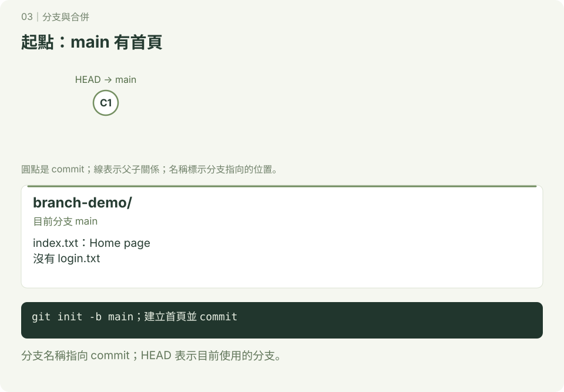
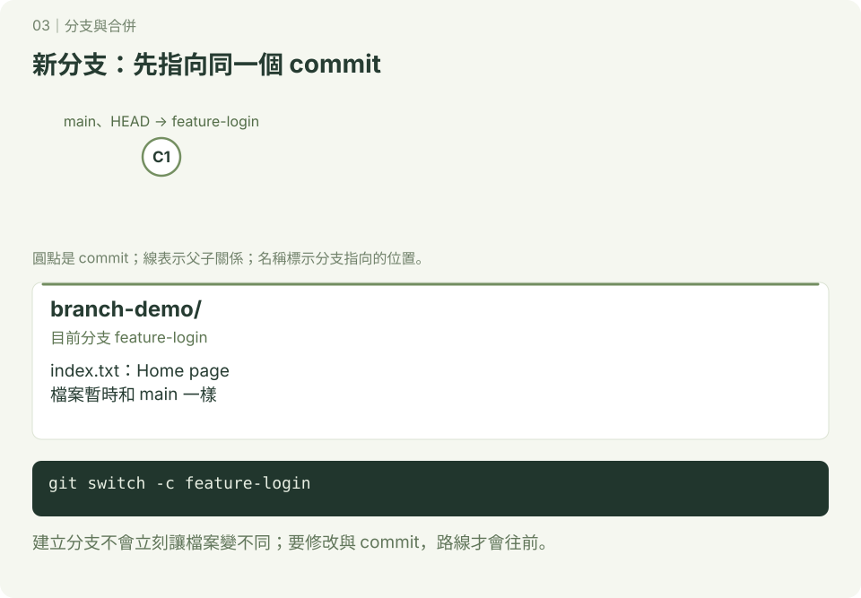
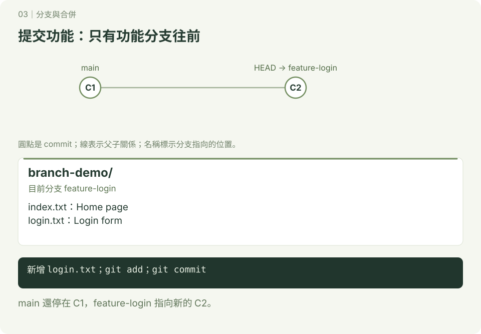
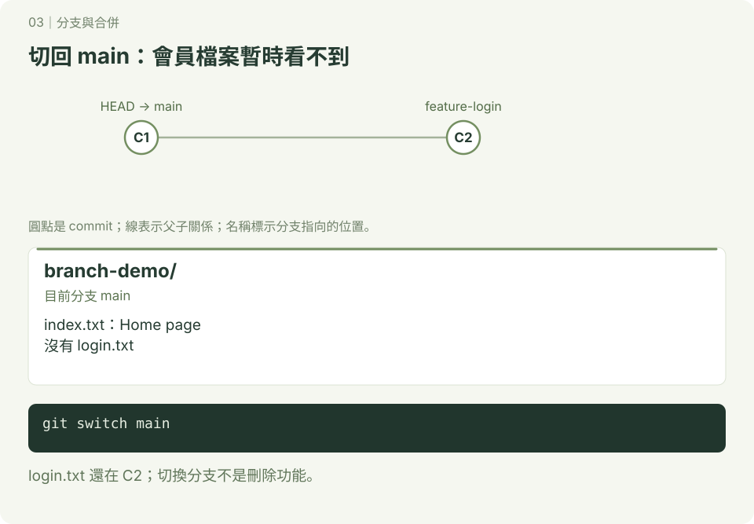
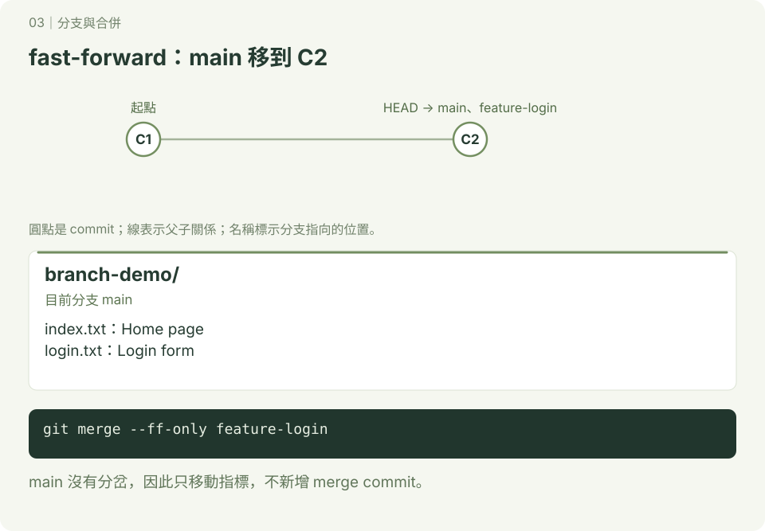
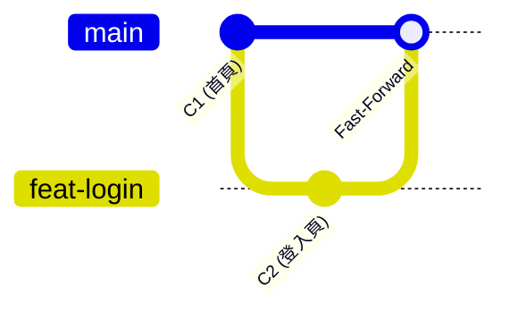
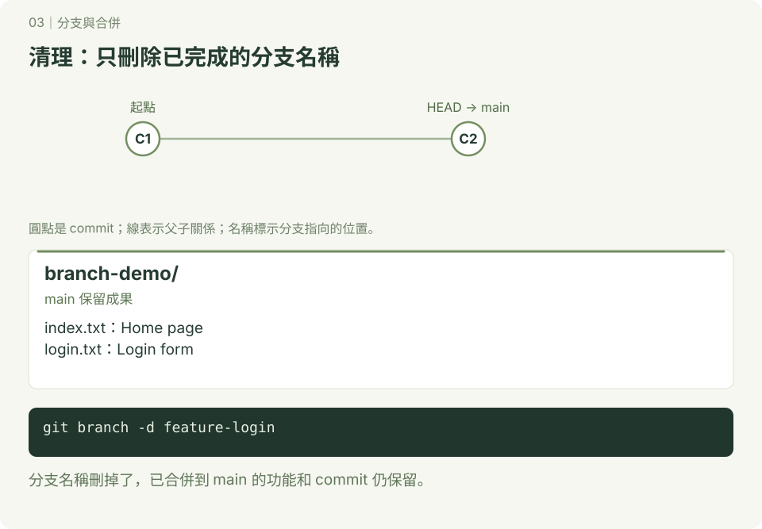
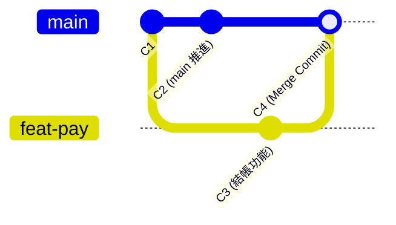

# 分支與合併

**建立版本 · 第 03 章**　[學習路線](../README.md) · [互動圖解](../docs/README.md)

本章附 SVG 圖解；可先讀 [互動版使用說明](../docs/README.md)，再用瀏覽器開啟 `docs/index.html#branch/1`，按下一步觀察變化。GitHub 的 README 顯示靜態圖，下載教材後即可離線操作互動版。

---

## 1. 核心觀念：什麼是分支？

當你想為專案新增一項實驗功能（例如：會員系統），但又不能影響目前已經能正常運行的版本時，**分支（Branch）** 就是最佳解法。

分支就像是專案的「**平行時空**」：你在分支上進行各種嘗試、修改甚至弄壞了，主要分支（`main`）都絲毫不受影響；等功能完整測試無誤後，再透過**合併（Merge）**整合回主線。

```text
               (你在 feature-login 上大膽開發)
               [ Login v1 ] ──> [ Login v2 ]
              ╱                              ╲  git merge
── [ 首頁 v1 ] ──────────────────────────────── [ 首頁 + 完整會員功能 ] (main)
               (主要版本 main 始終穩定運作)
```

### 三個核心術語

| 名稱 | 本質 | 比喻 |
| :--- | :--- | :--- |
| **Commit（提交）** | 一次已記錄的專案檔案快照 | 歷史紀錄點 |
| **Branch（分支）** | 一個指向某個 Commit 的可移動指標 | 書籤（會隨新提交自動往前移） |
| **HEAD** | 指向「目前所在位置」的特殊指標 | 「你目前站在哪個分支上」的標記 |

> [!TIP]
> **為什麼切換分支推薦使用 `git switch`？**  
> 過去 Git 切換分支與復原檔案都使用 `git checkout`，職責過多容易混淆。Git 2.23+ 正式推出 **`git switch`** 專職負責「切換與建立分支」，語意更清楚直觀，強烈建議全面改用 `git switch`。

---

## 2. 常用指令速查表

| 目的 | 指令 | 說明 |
| :--- | :--- | :--- |
| **查看目前分支** | `git branch --show-current` | 只印出當前所在分支名稱 |
| **查看所有本地分支** | `git branch` | 標有 `*` 代表目前分支 |
| **建立並切換到新分支** | `git switch -c <分支名稱>` | `-c` 即 create，建立並立即切換過去 |
| **切換至已存在的分支** | `git switch <分支名稱>` | 切換工作目錄到該分支最新狀態 |
| **快速切回上一個分支** | `git switch -` | 在最近兩個分支之間一秒快速切換 |
| **分支重新命名** | `git branch -m <舊名稱> <新名稱>` | 修改分支名稱（改當前分支可省略舊名） |
| **安全刪除已合併分支** | `git branch -d <分支名稱>` | 有保護機制，未合併前不會被誤刪 |
| **強制刪除未合併分支** | `git branch -D <分支名稱>` | 大寫 `-D` 強制丟棄該分支所有提交 |
| **合併分支至當前分支** | `git merge <來源分支>` | 將指定分支的成果整合進目前所在分支 |

---

## 3. 實戰範例：由淺入深操作指南

請開啟終端機或 Git Bash，在你的練習位置開始演練。

---

### 【階段一：基礎篇】建立起點與新分支

#### 步驟 1：建立專案與主要分支起點



```bash
mkdir branch-demo
cd branch-demo
git init -b main

# 建立首頁並提交
printf 'Home page\n' > index.txt
git add index.txt
git commit -m "feat: 建立首頁"
```
* **目前狀態**：主要分支為 `main`，指著第一筆 Commit，工作區有 `index.txt`。

#### 步驟 2：使用 `git switch -c` 建立並切換新分支



```bash
git switch -c feature-login
git branch
```
預期輸出：
```text
* feature-login
  main
```
* **解析**：
  * 星號 `*` 表示 `HEAD` 目前正指向 `feature-login`。
  * `switch -c` 會同時完成「建立」與「切換」兩件事。

---

### 【階段二：進階篇】獨立開發與檔案隔離驗證

#### 步驟 3：在分支上提交新功能



在 `feature-login` 分支上新增會員登入功能：

```bash
printf 'Login form\n' > login.txt
git add login.txt
git commit -m "feat: 新增會員登入頁"
ls
```
* **目前資料夾檔案**：`index.txt` 與 `login.txt`。

#### 步驟 4：切換回主要版本，驗證檔案隔離



```bash
git switch main
ls
```
預期輸出：
```text
index.txt
```
* **驗證成果**：工作目錄裡的 `login.txt` 不見了！  
  別擔心，檔案並沒有消失，而是安全保存在 `feature-login` 分支中。這就是分支帶來的**環境隔離**效果。

> [!TIP]
> **快速切換技巧**：輸入 `git switch -` 可以立刻切回 `feature-login`，再按一次 `git switch -` 又切回 `main`，在兩個分支來回比對時極為方便！

---

### 【階段三：管理篇】分支重新命名與刪除保護機制

#### 1. 重新命名分支（`git branch -m`）
若覺得功能名稱太長或需要規範化，可隨時改名：
```bash
# 將 feature-login 改名為 feat-login
git branch -m feature-login feat-login
git branch
```

#### 2. 安全刪除保護機制（`-d` vs `-D`）
假設我們隨意建立一個測試分支：
```bash
git switch -c temp-try
echo "測試設定" > temp.txt
git add temp.txt
git commit -m "test: 暫時性測試"

# 切回 main 嘗試刪除該分支
git switch main
git branch -d temp-try
```
終端機會發出警告：
```text
error: The branch 'temp-try' is not fully merged.
If you are sure you want to delete it, run 'git branch -D temp-try'.
```
* **保護機制**：`-d` 會檢查分支是否已合併。如果分支上還有未合併的 Commit，Git 會拒絕刪除以防心血白費。
* **確認放棄**：若確定不要這段程式碼，改用大寫 `-D` 才能強制刪除：
```bash
git branch -D temp-try
```

---

### 【階段四：核心篇】分支合併（Merge）三大情境

> **合併重要原則**：「**先切回接收端（如 main），再合併來源端（功能分支）**」。

---

#### 情境 A：快轉合併（Fast-Forward Merge）

當 `feat-login` 在開發時，`main` **完全沒有任何新的 Commit**。此時合併極為單純，Git 只要將 `main` 的指標直接「往前移」到最新 Commit 即可。





##### 執行合併與驗證：
```bash
# 1. 確保目前在 main
git switch main

# 2. 執行快轉合併（加入 --ff-only 可確保若非快轉則拒絕，避免意外產生 merge commit）
git merge --ff-only feat-login

# 3. 檢查檔案
cat login.txt
git log --oneline --graph
```
預期輸出：`login.txt` 成功出現在 `main` 分支上，歷史記錄呈現一條筆直的直線。

##### 步驟 6：刪除已整合的任務分支



功能已經順利進入主要版本，分支名稱功成身退：

```bash
git branch -d feat-login
git branch
```
* **預期結果**：只剩下 `main` 分支。刪除書籤（分支指針）並不會刪除已經合併進專案的檔案與提交紀錄。

---

#### 情境 B：三方合併（3-Way Merge / 非快轉合併）

當功能分支在開發時，`main` 也同時被加入了其他修改（例如緊急修復或他人提交），兩邊歷史出現分岔。Git 會自動找到共同祖先，並產生一個專門的 **Merge Commit**。



##### 模擬操作：
```bash
# 1. 開出購物車分支並開發
git switch -c feat-cart
echo "購物車清單" > cart.txt
git add cart.txt
git commit -m "feat: 新增購物車"

# 2. 切回 main，同時 main 也有新的更新
git switch main
echo "網站版權 2026" >> index.txt
git add index.txt
git commit -m "docs: 更新首頁版權宣告"

# 3. 執行合併
git merge feat-cart -m "merge: 將購物車功能合併回 main"

# 4. 查看漂亮的分岔與匯流圖
git log --oneline --graph --all
```
* **結果**：歷史線圖會呈現清晰的分岔與匯流節點，完整保留兩邊的開發脈絡。

---

#### 情境 C：衝突解決實戰（Merge Conflict）

當兩邊分支**改動了同一個檔案的相同行數**，Git 無法替你決定該保留誰，就會觸發衝突（Conflict）。

##### 1. 製造衝突場景：
```bash
# 開新分支修改首頁第一行
git switch -c feat-title-a
echo "標題：我的超棒網站" > index.txt
git add index.txt
git commit -m "style: 改用標題 A"

# 切回 main，也在同一行改了不同標題
git switch main
echo "標題：個人官方首頁" > index.txt
git add index.txt
git commit -m "style: 改用標題 B"
```

##### 2. 執行合併觸發衝突：
```bash
git merge feat-title-a
```
終端機輸出提示：
```text
Auto-merging index.txt
CONFLICT (content): Merge conflict in index.txt
Automatic merge failed; fix conflicts and then commit the result.
```

##### 3. 解決衝突三步驟：
開啟衝突檔案 `index.txt`，會看到 Git 標註的衝突標籤：
```text
<<<<<<< HEAD
標題：個人官方首頁
=======
標題：我的超棒網站
>>>>>>> feat-title-a
```
* `<<<<<<< HEAD` 到 `=======`：代表目前分支（`main`）的內容。
* `=======` 到 `>>>>>>> feat-title-a`：代表欲合併分支的內容。

**手動修改檔案**，決定最終結果（例如雙方討論後合併為一行），並清除所有標籤：
```text
標題：個人官方首頁（超棒版）
```

**標記解決並提交**：
```bash
git add index.txt
git commit -m "fix: 解決首頁標題合併衝突"
git branch -d feat-title-a
```
衝突順利排除，合併正式完成！

---

## 4. 自己動手做

請在 `branch-demo` 專案中練習完整流程：

1. 從 `main` 分支建立並切換到 `feature-about`。
2. 新增 `about.txt`，寫入一段自我介紹並提交：`feat: 新增關於我們頁面`。
3. 使用 `git switch main` 切回主線，確認此時工作目錄看不到 `about.txt`。
4. 使用 `git merge --ff-only feature-about` 完成快轉合併。
5. 確認 `about.txt` 出現在 `main` 後，安全刪除 `feature-about` 分支。

**驗收標準**：
* 專案內包含 `index.txt` 與 `about.txt`。
* 執行 `git branch` 僅剩 `main` 分支。
* 執行 `git status` 顯示工作目錄完全乾淨（`working tree clean`）。

---

## 5. 進階概念速查

| 合併方式 | 指令 | 歷史會長怎樣？ | 適用時機 |
| :--- | :--- | :--- | :--- |
| **快轉合併 (Fast-Forward)** | `git merge <分支>` | 直線前進，不產生額外節點 | 小型功能分支、單人開發 |
| **強迫建立合併節點** | `git merge --no-ff <分支>` | 即使能快轉，也硬留一個 Merge Commit | 團隊開發、想明確留下「某功能何時併入」的里程碑 |
| **壓平合併 (Squash)** | `git merge --squash <分支>` | 把該分支的十幾筆零碎 commit 濃縮成一筆提交 | 清理功能分支中瑣碎的「改錯字」、「微調」記錄 |
| **基底重定 (Rebase)** | `git rebase <目標分支>` | 拔下當前分支的 commit，改接在目標分支最新節點上 | 保持專案歷史整潔無分岔（注意：已推遠端的分支切勿 rebase） |

---

[← main、HEAD 與歷史](../使用main主要分支/README.md)　｜　[忽略不需要追蹤的檔案 →](../不想被追蹤的檔案/README.md)
