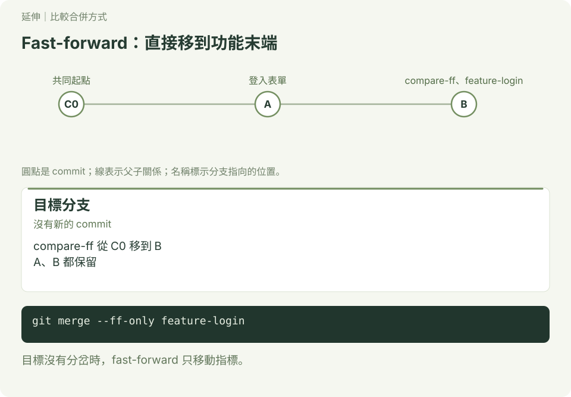
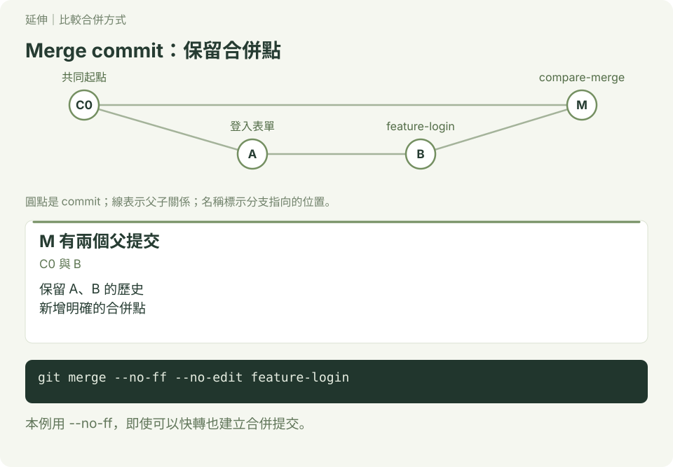
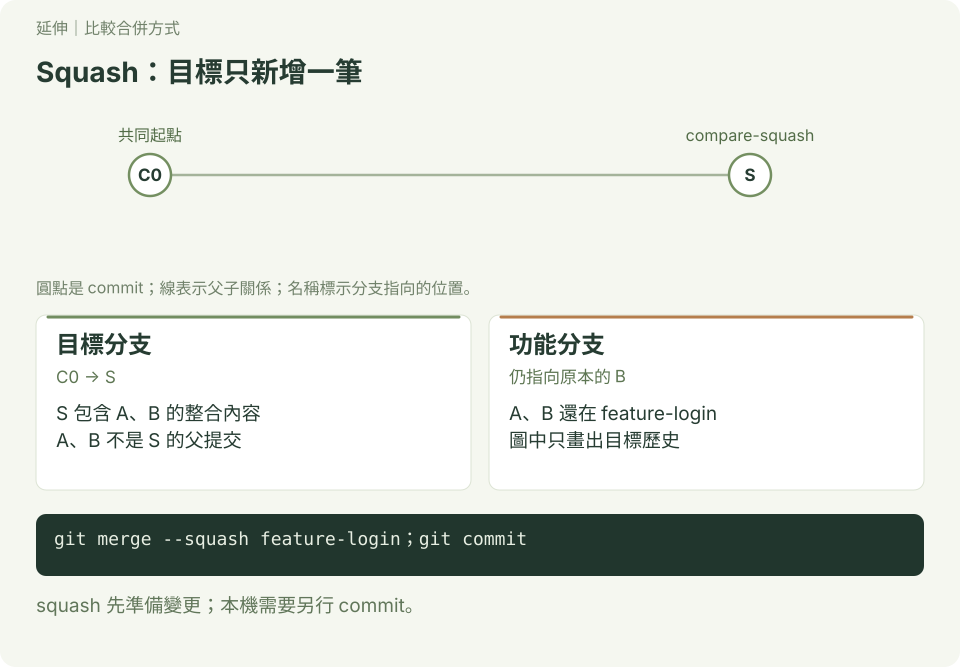
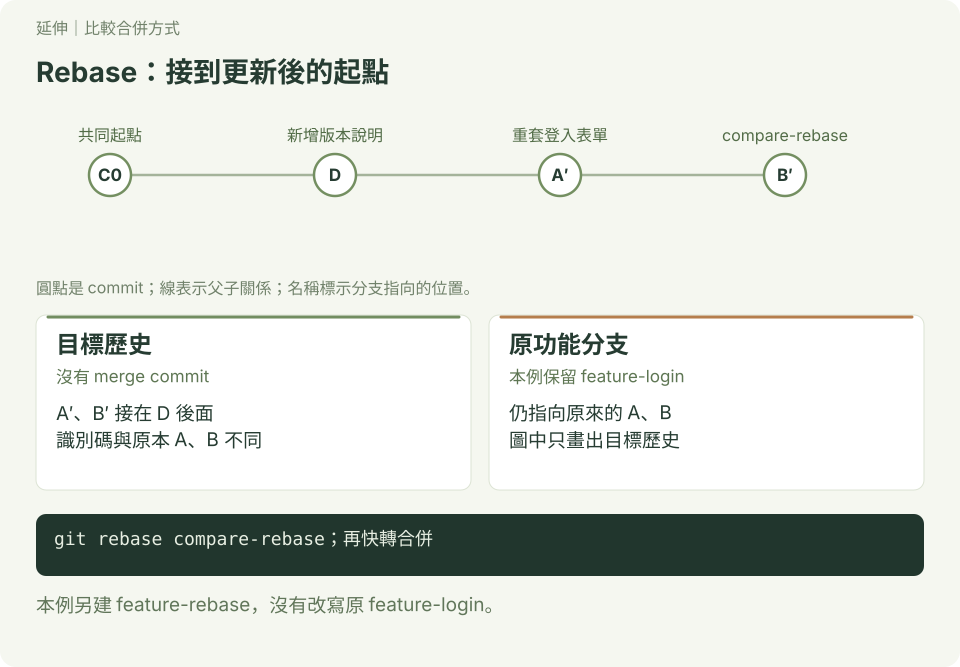

# 比較合併方式：同一份功能，不同的歷史

完成[分支與合併](./README.md)後，閱讀本頁。你會用同一個練習專案比較 fast-forward、merge commit、squash，以及把功能分支 rebase 到更新後的 main。最後再對照 GitHub PR 的三個選項。

## 1. 先看差別

假設功能有兩筆提交 A、B，main 一開始指向它們的共同起點 C0。下面的字母只是圖上的代號，實際識別碼會不同。

| 操作 | 目標分支的歷史 | 什麼時候用？ |
| --- | --- | --- |
| Fast-forward | main 直接移到 B，不產生新提交 | main 沒有從共同起點另行前進時 |
| Merge commit | 保留 A、B，再建立有兩個父提交的 M | 想保留各筆提交與明確的合併點 |
| Squash | A、B 的內容整理成一筆新的 S | 一個功能有很多零碎提交，想讓目標分支只看到一筆 |
| Rebase 後整合 | 將功能提交重新套到目標版本之後，形成 A′、B′ | 需要直線歷史，且團隊同意如何處理改寫歷史 |

**衝突不是另一種合併方式。** 不論採用哪種方法，若修改互相衝突，都可能需要人工處理。以下練習只在自己的新專案進行，不使用網路。

## 2. 準備共同起點

使用 macOS／Linux 終端機或 Windows Git Bash，已設定提交姓名與信箱；在你選擇的練習位置確認 `merge-compare` 尚不存在。所有步驟按順序執行，操作位置都在 `merge-compare`。

```bash
mkdir merge-compare
cd merge-compare
git init -b main
printf 'Home\n' > index.txt
git add index.txt
git commit -m "C0 建立首頁"
git branch start
git switch -c feature-login
printf 'Login form\n' >> index.txt
git add index.txt
git commit -m "A 新增登入表單"
printf 'Password field\n' >> index.txt
git add index.txt
git commit -m "B 新增密碼欄位"
git log --oneline --all --graph --decorate
```

現在 `main` 和 `start` 都在 C0；`feature-login` 包含 A、B。接下來用三個比較分支模擬 main：每個都從 `start` 建立，**不必重做前面的提交**。這些分支互相獨立，功能分支也會保留。

## 3. Fast-forward：直接移動分支



```bash
git switch -c compare-ff start
git merge --ff-only feature-login
git log --oneline --first-parent -3
cat index.txt
```

預期歷史由新到舊是 B、A、C0；檔案有 Home、Login form、Password field 三行。因為目標分支還在 C0，可以直接移到 B，沒有新的 merge commit。`--ff-only` 只允許快轉，若目標已分岔則拒絕。

## 4. Merge commit：保留合併點



```bash
git switch -c compare-merge start
git merge --no-ff --no-edit feature-login
git log --oneline --graph --decorate -4
git show -s --format=%P HEAD
git diff compare-ff compare-merge -- index.txt
```

`--no-ff` 即使可以快轉也建立 merge commit；`--no-edit` 使用預設訊息。`git show` 會列出 M 的兩個父提交識別碼：C0 與 B。最後的 diff 沒有輸出，表示這兩種做法的 `index.txt` 最終內容相同；歷史不同。GitHub 的 **Merge pull request** 使用這種保留合併點的方式。

## 5. Squash：把內容整理成一筆



```bash
git switch -c compare-squash start
git merge --squash feature-login
git status --short
git diff --staged
git commit -m "S 完成登入功能"
git log --oneline --first-parent -2
git diff compare-ff compare-squash -- index.txt
```

`merge --squash` 先把整合結果放進工作區與暫存區，**還沒有建立提交**，所以要再 commit。目標歷史現在是 C0 → S，最後的 diff 沒有輸出。A、B 仍由 `feature-login` 指向，但不是 S 的父提交；因此 Git 不會把原功能分支視為已經以一般 merge 完整合併。清理分支或再次整合同一分支前，先確認實際成果與團隊流程。

GitHub 的 **Squash and merge** 也會把 PR 的變更整理成目標分支上的一筆提交；本機這段指令只是讓你觀察相似的歷史結果。

## 6. Rebase：先接到新的起點，再整合



前三個比較的目標分支都還在 C0。這次另建 `compare-rebase`，模擬 main 在功能開發期間新增 D；再複製功能分支來練習，保留原本的 `feature-login`：

```bash
git switch -c compare-rebase start
printf 'Release notes\n' > release.txt
git add release.txt
git commit -m "D 新增版本說明"
git switch -c feature-rebase feature-login
git rebase compare-rebase
git log --oneline --graph --decorate -4
git switch compare-rebase
git merge --ff-only feature-rebase
git log --oneline --first-parent -4
git diff compare-ff compare-rebase -- index.txt
```

預期目標歷史是 C0 → D → A′ → B′，沒有 merge commit。A′、B′ 是把 A、B 的修改重新套用後產生的新提交，識別碼不同；原 `feature-login` 仍指向原來的 A、B。最後一個 diff 沒有輸出，表示登入功能內容一致；`compare-rebase` 另外有 D 新增的 `release.txt`。

這是**本機 rebase 後快轉合併**的示範，與 GitHub 的 **Rebase and merge** 有相似的直線結果；GitHub 會建立新的提交識別碼，細節不完全等同於每一次本機 rebase。若目標沒有前進，本機 rebase 可能不需要重建提交。已分享的分支不要自行改寫，先與團隊約定；發生衝突時參考 [rebase 卡關處理](../git_rebase/README.md)。

## 7. GitHub PR 怎麼選？

| GitHub 選項 | 目標分支看到什麼 | 可能的取捨 |
| --- | --- | --- |
| Merge pull request | 保留 PR 的各筆提交，再加 merge commit | 歷史較完整，也會多一個合併點 |
| Squash and merge | PR 的變更整理成一筆提交 | 容易閱讀；目標分支看不到原本各筆提交的先後 |
| Rebase and merge | PR 的提交重新建立並依序接到目標分支 | 歷史直線；提交識別碼改變 |

可選項目受儲存庫設定、權限與 PR 狀態影響，請以團隊約定為準。本機的 `git merge --ff-only` 是快轉條件，不是 GitHub PR 的第四個按鈕。

## 8. 換你判斷

1. `compare-ff` 與 `compare-merge` 的檔案相同，為什麼一個有 M、一個沒有？
2. `compare-squash` 的 S 是否以 A、B 作為父提交？原本的 A、B 還在哪裡？
3. 為什麼 `compare-rebase` 額外有 `release.txt`？可以直接對已被同學使用的分支任意 rebase 嗎？

答案：第一個快轉、第二個刻意建立合併點；S 的父提交是 C0，原 A、B 仍在功能分支；D 在 rebase 前已加入目標分支，共享分支要先與團隊協調。

參考：[Git merge 文件](https://git-scm.com/docs/git-merge)、[GitHub PR 合併方式](https://docs.github.com/en/pull-requests/reference/pull-request-merges)。

[← 分支與合併](./README.md)　｜　[衝突練習 →](./延伸範例.md)
