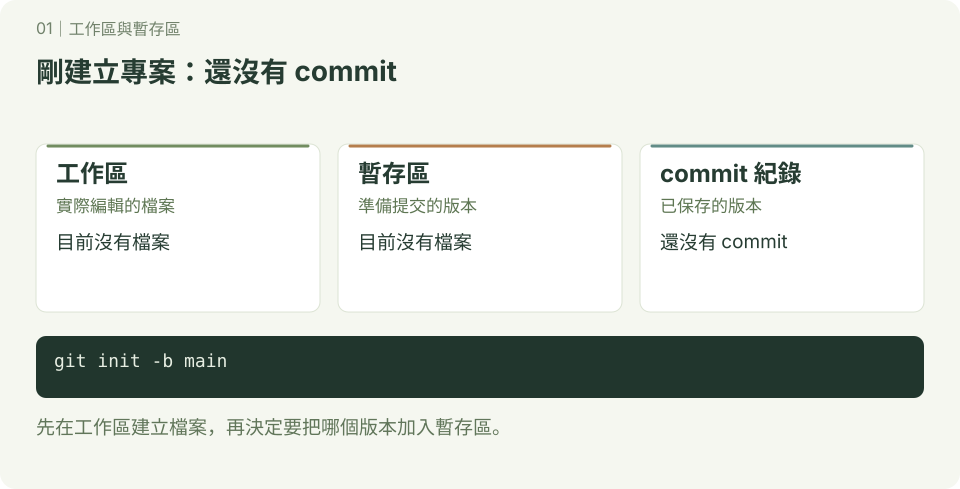

# 工作區、暫存區與 commit

**建立版本 · 第 01 章**　[學習路線](../README.md) · [互動圖解](../docs/README.md)

這一章會建立一個練習專案，學會用 `status` 檢查狀態、用 `add` 選擇要保存的內容，再用 `commit` 建立記錄點。請先完成[環境安裝與設定](../環境安裝與設定/README.md)及 [VS Code Source Control 入門](../VSCode入門/README.md)，並在範例課程練習幾次 Commit。這裡的指令可在 VS Code Terminal 執行，與圖形介面操作同一個 Git。

## 1. 先認識三個位置

| 位置 | 用途 | 例子 |
| --- | --- | --- |
| 工作區 | 你目前編輯的檔案 | 剛寫好的 `index.txt` |
| 暫存區 | 準備放進下一筆 commit 的檔案版本 | 執行 `git add index.txt` 時的內容 |
| commit 紀錄 | 已保存的版本紀錄 | 執行 `git commit` 後的記錄點 |

`git add` 保存檔案**當下的版本**到暫存區；之後再修改檔案，暫存區不會自動更新。`git commit` 記錄的是暫存區的內容。



## 2. 跟著做：建立第一筆 commit

以下使用 VS Code Terminal 的 macOS／Linux shell 或 Windows Git Bash。選一個練習位置，確認 `git-first` 資料夾尚不存在，且不在另一個 Repository 裡。每個 `bash` 區塊是要輸入的指令；`text` 是預期結果，不用輸入。

```bash
mkdir git-first
cd git-first
git init -b main
printf 'Home page\n' > index.txt
git status --short
```

預期看到 `?? index.txt`：檔案存在，但 Git 尚未追蹤。接著選擇檔案並建立記錄點：

```bash
git add index.txt
git status --short
git commit -m "新增首頁"
git status --short
git log --oneline
```

第一次 `status` 顯示 `A  index.txt`，表示新增的檔案已暫存；commit 後的 `status --short` 沒有輸出，表示沒有待處理的差異。`log` 會顯示提交訊息和一串識別碼，識別碼每個人不同。檔案與暫存區並沒有因為 commit 而消失。

## 3. 跟著做：add 後再修改

操作位置仍在 `git-first`。先暫存第一行修改，再加入第二行：

```bash
printf 'About our team\n' >> index.txt
git add index.txt
printf 'Contact us\n' >> index.txt
git status --short
git diff
git diff --staged
```

`status` 會顯示 `MM index.txt`：第一個 `M` 表示已暫存的修改，第二個 `M` 表示暫存後又有修改。`git diff` 比較工作區與暫存區，看到 `Contact us`；`git diff --staged` 比較暫存區與最新 commit，看到 `About our team`。

現在先提交暫存的版本，再檢查：

```bash
git commit -m "新增團隊介紹"
git show --stat --oneline HEAD
git status --short
```

這筆 commit 包含 `About our team`，但不包含稍後加入的 `Contact us`；該行仍留在工作區，狀態顯示 ` M index.txt`。把剩下的修改也保存：

```bash
git add index.txt
git commit -m "新增聯絡資訊"
git status --short
git log --oneline
```

完成後狀態沒有輸出，歷史有三筆提交。想檢查各筆內容，可以執行 `git show HEAD` 查看最新提交。

## 4. 換你做

在同一個 `git-first` 建立 `about.txt`，寫一句介紹，使用 `status`、`add`、`commit` 保存，再用 `git log --oneline` 確認。完成後，試著回答：

1. 修改檔案後，為什麼要重新 `git add`？
2. `git diff` 和 `git diff --staged` 各看哪兩個位置的差異？
3. `status --short` 沒有輸出，代表檔案消失了嗎？

答案：暫存區保留的是 add 當下的版本；兩個 diff 分別比較工作區與暫存區、暫存區與最新提交；乾淨狀態只表示沒有待處理的差異。

要取消暫存或還原修改時，參考[還原檔案與取消暫存](../回復被刪除的檔案或被編輯的內容/README.md)；修改最後一筆提交請看[整理最後一筆提交](../修改目前commit/README.md)。

想多練習 diff 與選擇提交內容，可以參考[延伸範例](./延伸範例.md)。

---

[← 環境安裝與設定](../環境安裝與設定/README.md)　｜　[main、HEAD 與歷史 →](../使用main主要分支/README.md)
