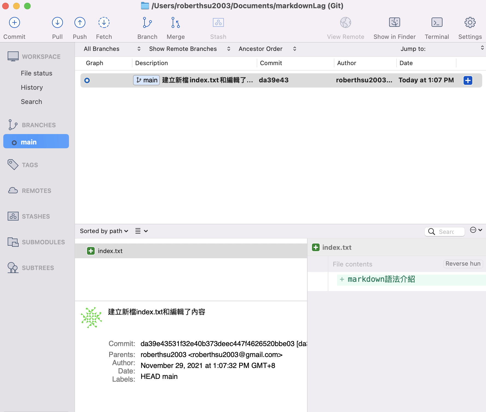

# 工作區與暫存區

**建立版本 · 第 01 章**　[學習路線](../README.md) · [互動圖解](../docs/README.md)

Git 記錄專案版本，讓你比較修改、回看已提交內容。它不會自動保存所有檔案；整個資料夾連同 `.git` 都刪掉時，本地歷史也會消失。重要專案還需要遠端儲存庫或備份。

---

## 1. 三個區域先分清楚

在 Git 中，檔案會在三個核心區域之間流轉：

```text
┌─────────────────────────┐       git add        ┌─────────────────────────┐      git commit      ┌─────────────────────────┐
│         工作區           │  ─────────────────>  │         暫存區           │  ─────────────────>  │       本地儲存庫         │
│  (Workspace / Worktree) │                      │     (Staged / Index)    │                      │  (Repository / commit)  │
│      實際編輯的檔案       │  <─────────────────  │       準備提交的快照     │                      │       歷史版本記錄       │
└─────────────────────────┘   git restore        └─────────────────────────┘                      └─────────────────────────┘
                              git restore --staged (移出暫存區)
```

| 區域 | 保存什麼？ | 用途說明與比喻 | 怎麼更新？ |
| :--- | :--- | :--- | :--- |
| **工作區 (Workspace)** | 現在磁碟上實際編輯的檔案 | **「你的書桌」**：你用編輯器打開、撰寫筆記或程式碼的地方。只要存檔，變動就在這裡。 | 編輯器存檔、新增或刪除檔案 |
| **暫存區 (Staged / Index)** | 下一次提交要使用的檔案快照 | **「購物車 / 封箱清單」**：暫時挑選要結帳的商品。讓你能精準挑選要提交的改動，分批存檔。 | `git add <檔案>` |
| **本地庫 (commit / HEAD)** | 已記錄的專案永久快照與訊息 | **「倉庫貨架」**：正式將包裹封箱入庫，永久保存為一筆歷史紀錄。 | `git commit -m "說明"` |

> [!IMPORTANT]
> **commit 只會記錄「暫存區」裡的版本**。  
> 執行 `git add` 後如果你又修改了檔案，新的修改**不會**自動進入暫存區！此時若直接 commit，只會保存執行 `add` 那個當下的版本。

---

## 2. 如何回復工作區？如何回復暫存區？

在開發過程中，常常會遇到寫壞想反悔、或是手滑太早 `add` 的情況。請務必牢記以下兩種回復方式：

### (1) 如何回復工作區（放棄工作區修改）
* **先決條件（重要觀念）**：**該檔案必須是「已被追蹤（Tracked）」的檔案**（即至少曾經 commit 過或至少被 add 過）。如果是全新建立、從未被 Git 追蹤的新檔案（`??`），Git 沒有歷史快照可以還原，執行 `git restore` 會出現 `pathspec did not match any file(s) known to git` 錯誤（未追蹤新檔欲清除請手動刪除或使用 `git clean -f`）。
* **情境**：已追蹤的檔案在編輯器裡改爛了、格式全毀，但**尚未執行 `git add`**。你想放棄這次的修改，還原回「暫存區」或「最後一次 commit」的乾淨狀態。
* **指令**：
  ```bash
  git restore <檔案名稱>        # 放棄單一檔案的工作區修改（限已追蹤檔案）
  git restore .                 # 放棄當前目錄下所有已追蹤檔案的工作區修改
  ```
  *(舊版 Git 指令為 `git checkout -- <檔案名稱>`)*

### (2) 如何回復暫存區（將檔案移出暫存區，退回工作區）
* **情境**：不小心太早執行了 `git add`，但檔案還沒改完整，想把檔案**從暫存區抽出來（拿出購物車）**，但**要保留剛寫好的程式碼與文字**在工作區繼續改。
* **標準指令（專案已至少有一次 commit 時）**：
  ```bash
  git restore --staged <檔案名稱>    # 將單一檔案移出暫存區（保留工作區內容）
  git restore --staged .             # 將所有已暫存檔案移出暫存區
  ```
  *(舊版 Git 指令為 `git reset HEAD <檔案名稱>`)*

> [!WARNING]
> **新手必踩大坑：為什麼會報錯「致命錯誤：無法解析『HEAD』」？**  
> * **發生原因**：剛 `git init` 出來的全新專案，在**尚未完成第一次 Commit（尚無提交）** 之前，Git 倉庫裡**根本還沒有 `HEAD` 指標**（因為 HEAD 指向最近一次 commit）。此時若執行依賴 HEAD 的 `git restore --staged` 就會報錯！
> * **第一次 Commit 前的解法**：使用 `git rm --cached` 取消暫存：
>   ```bash
>   git rm --cached <檔案名稱>        # 在尚無任何 commit 時，將檔案移出暫存區（回到未追蹤 ?? 狀態，不刪除實體檔案）
>   ```
>   *(一旦完成過第 1 次 commit，後續就可以全面使用標準的 `git restore --staged`)*

### (3) 指令快速對照表

| 操作需求 | 作用目標 | 推薦指令 | 注意事項與先決條件 |
| :--- | :--- | :--- | :--- |
| **放棄工作區改動** | 工作區 → 還原 | `git restore <file>` | ⚠️ **會遺失**未暫存的修改（**限已追蹤檔案**） |
| **撤回暫存狀態**（已有 commit） | 暫存區 → 工作區 | `git restore --staged <file>` | ✅ **不會遺失**，檔案保留在工作區 |
| **撤回暫存狀態**（尚未有 commit） | 暫存區 → 工作區 | `git rm --cached <file>` | ✅ **不會遺失**，避免出現「無法解析 HEAD」錯誤 |
| **徹底還原雙區** | 同時放棄暫存與工作區 | `git restore --source=HEAD --staged --worktree <file>` | ⚠️ **會遺失**所有未提交改動 |
| **清理未追蹤新檔** | 刪除未追蹤的檔案 | `git clean -fd` | ⚠️ **會刪除**新建且未追蹤的檔案 |

---

## 3. 實戰演練：Git Add 與 Markdown 語法教學（5 個完整範例）

我們透過邊寫 **Markdown 筆記** 邊練習 **Git 指令**，一步步熟悉工作區、暫存區與回復操作！

請先在終端機建立一個獨立的練習目錄：
```bash
mkdir staging-demo
cd staging-demo
git init -b main
```

---

### 範例一：初探暫存區 —— 建立標題與清單（`git add` 基本用法）

#### 📝 Markdown 語法教室：標題與清單
* `#` 代表一級標題、`##` 二級標題、`###` 三級標題（`#` 後面必須加一個空格）。
* `-` 或 `*` 代表無序清單。
* `1.`、`2.` 代表有序編號清單。

#### 💻 Git 實作步驟：
1. **建立 Markdown 檔案並寫入內容**：
   ```bash
   cat << 'EOF' > notes.md
   # Markdown 學習筆記

   ## 今日學習目標
   - 認識 Git 工作區與暫存區
   - 熟悉 Markdown 常用語法

   ## 推薦步驟
   1. 建立標題與清單
   2. 粗體、斜體與超連結
   3. 程式碼區塊與引言
   EOF
   ```
2. **觀察狀態**：
   ```bash
   git status --short
   ```
   ```text
   ?? notes.md
   ```
   `??` 表示檔案僅存在於**工作區**，屬於**未追蹤（Untracked）** 檔案。

   > 💡 **新手常問：為什麼這時候執行 `git diff` 是一片空白？**  
   > 因為 `git diff` 比較的是「工作區 vs 暫存區（Index）」。這個新檔案**從未被加入過暫存區（尚未被追蹤）**，Index 裡完全沒有它的紀錄，所以 `git diff` 預設不會顯示任何未追蹤檔案的差異。要查看新檔案請使用 `git status`！

3. **加入暫存區並提交**：
   ```bash
   git add notes.md
   git status --short
   ```
   ```text
   A  notes.md
   ```
   `A ` 代表已經加入**暫存區**（準備好提交新增）。接著進行首次提交：
   ```bash
   git commit -m "docs: 建立筆記並新增標題與清單"
   ```

---

### 範例二：暫存區是「快照」而非檔案指標 —— 粗體、斜體與超連結（理解 `AM` 狀態）

#### 📝 Markdown 語法教室：強調文字與連結
* 粗體：`**粗體文字**`
* 斜體：`*斜體文字*`
* 粗斜體：`***粗斜體文字***`
* 刪除線：`~~劃掉文字~~`
* 超連結：`[連結顯示文字](網址)`

#### 💻 Git 實作步驟：
1. **修改工作區的 `notes.md`**：
   ```bash
   cat << 'EOF' >> notes.md

   ## 重點觀念
   - **重要**：Git add 保存的是**當下快照（Snapshot）**。
   - *提示*：善用 `git status` 觀察檔案所處區域。
   - 參考文件：[Git 官方網站](https://git-scm.com/)
   EOF
   ```
2. **加入暫存區**：
   ```bash
   git add notes.md
   git status --short
   ```
   ```text
   M  notes.md
   ```
   綠色 `M ` 代表修改已經**進入暫存區**。
3. **關鍵體驗：暫存後又在工作區修改**：
   ```bash
   echo "- ~~這是過時的訊息~~" >> notes.md
   git status --short
   ```
   ```text
   AM notes.md
   ```
   > 💡 **解讀 `AM`**：
   > * 左邊的 `A/M`：暫存區裡有一份待提交的版本（剛才加了粗體與連結的狀態）。
   > * 右邊的 `M`：工作區在 add 之後又有新改動（追加了刪除線）。
   > * **如果現在執行 `git commit`，只會保存暫存區的版本，刪除線那行不會被存進去！**
4. **重新 add 並提交**：
   ```bash
   git add notes.md
   git commit -m "docs: 補充強調語法、連結與刪除線"
   ```

---

### 範例三：回復工作區的修改 —— 程式碼區塊與引言（`git restore`）

#### 📝 Markdown 語法教室：程式碼與引用區塊
* 行內程式碼：使用一對反引號 \`code\`。
* 多行程式碼區塊：使用三個反引號包裹，並可指定語言（例如 \`\`\`bash）。
* 引言（區塊引用）：在行首加上 `>`。

#### 💻 Git 實作步驟：
1. **正常新增程式碼範例並提交**：
   ```bash
   cat << 'EOF' >> notes.md

   ## 常用終端機指令
   > 以下為常用的 Git 查詢指令：

   ```bash
   git status -s
   git log --oneline
   ```
   EOF
   git add notes.md
   git commit -m "docs: 新增程式碼區塊與引言"
   ```
2. **模擬情境：學生不小心在工作區改壞了格式**：
   ```bash
   echo "哎呀！不小心打錯字、把整份筆記覆蓋弄壞了！" > notes.md
   ```
3. **檢視工作區差異**：
   ```bash
   git diff
   ```
   會看到滿江紅的刪除標記，顯示工作區已被破壞。
4. **【核心操作：回復工作區】**：
   ```bash
   git restore notes.md
   ```
5. **確認結果**：
   ```bash
   git status
   tail -n 8 notes.md
   ```
   工作區立刻恢復原狀，剛才寫爛的修改已被安全丟棄！

---

### 範例四：回復暫存區的狀態 —— 表格與任務清單（`git restore --staged`）

#### 📝 Markdown 語法教室：表格與核取清單
* 表格：以 `|` 分隔欄位，第二行使用 `| :--- | :---: | ---: |` 設定靠左、置中或靠右。
* 任務核取清單：`- [ ] 未完成`、`- [x] 已完成`。

#### 💻 Git 實作步驟：
1. **在 `notes.md` 追加表格與待辦清單**：
   ```bash
   cat << 'EOF' >> notes.md

   ## 指令速查表
   | 指令 | 作用區域 | 說明 |
   | :--- | :--- | :--- |
   | `git add` | 工作區 → 暫存區 | 放入購物車 |
   | `git restore --staged` | 暫存區 → 工作區 | 移出購物車 |

   ## 練習清單
   - [x] 完成表格語法學習
   - [ ] 練習回復暫存區
   EOF
   ```
2. **手滑太快加進暫存區**：
   ```bash
   git add notes.md
   git status --short
   ```
   ```text
   M  notes.md
   ```
   檔案已經被放進暫存區，但你突然想起清單第二項還沒勾選，想退回工作區繼續編輯。
3. **【核心操作：回復暫存區】**：
   ```bash
   git restore --staged notes.md
   git status --short
   ```
   ```text
    M notes.md
   ```
   綠色 `M ` 變成了紅色 ` M`！檔案成功**移出暫存區**回到工作區，而且**剛打好的文字完全保留**。
4. **繼續修改、重新暫存並提交**：
   在工作區中將 `[ ]` 改為 `[x]` 後提交：
   ```bash
   # 將未完成改為已完成
   sed -i '' 's/- \[ \] 練習回復暫存區/- \[x\] 練習回復暫存區/' notes.md 2>/dev/null || sed -i 's/- \[ \] 練習回復暫存區/- \[x\] 練習回復暫存區/' notes.md
   git add notes.md
   git commit -m "docs: 完成表格與任務清單練習"
   ```

---

### 範例五：多檔案綜合實戰 —— 圖片語法與分隔線（雙區檢視與選擇性回復）

#### 📝 Markdown 語法教室：圖片與水平分隔線
* 圖片語法：``
* 水平分隔線：獨立一行的三個減號 `---`（前後保持空行）。

#### 💻 Git 實作步驟：
1. **建立第二個檔案 `REFERENCE.md` 並提交**：
   ```bash
   cat << 'EOF' > REFERENCE.md
   # 常用 Markdown 資源

   ---

   

   * 支援標準：CommonMark 與 GitHub Flavored Markdown (GFM)
   EOF
   git add REFERENCE.md
   git commit -m "docs: 建立參考資料檔案"
   ```
2. **同時修改兩個檔案**：
   - 在 `REFERENCE.md` 新增有價值的筆記：
     ```bash
     echo "- [GFM 規格手冊](https://github.github.com/gfm/)" >> REFERENCE.md
     ```
   - 在 `notes.md` 隨手打了一行測試廢話：
     ```bash
     echo "這是一段測試文字，稍後要丟棄" >> notes.md
     ```
3. **只把 `REFERENCE.md` 加入暫存區**：
   ```bash
   git add REFERENCE.md
   git status --short
   ```
   ```text
   M  REFERENCE.md
    M notes.md
   ```
4. **使用 `git diff` 與 `git diff --staged` 進行兩區比對**：
   ```bash
   # 查看工作區尚未暫存的修改（只會列出 notes.md 的廢話）
   git diff

   # 查看暫存區準備提交的修改（只會列出 REFERENCE.md 的連結）
   git diff --staged
   ```
5. **精準選擇：回復工作區的廢話，順利提交暫存區的檔案**：
   ```bash
   # 放棄 notes.md 的測試廢話
   git restore notes.md

   # 提交暫存區中正常的 REFERENCE.md
   git commit -m "docs: 更新 GFM 參考手冊連結"
   ```
6. **確認狀態與歷史**：
   ```bash
   git status
   git log --oneline -n 3
   ```
   狀態回到乾淨的 `working tree clean`，每個版本修改明確且獨立！

---

## 4. `git diff` 的使用方法與解讀技巧

在執行 `git commit` 存檔之前，**養成「先看 diff 檢查改動」的習慣**，是專業開發者避免把測試代碼或機密檔案提交出去的最關鍵防線！

> [!IMPORTANT]
> **關鍵先決條件：為什麼新檔案下 `git diff` 什麼都不會顯示？**  
> * `git diff` 的預設行為是比對「**工作區 vs 暫存區（Index）**」。
> * 只有**被追蹤過（Tracked）** 的檔案（即檔案已經存在於暫存區或歷史 commit 中），Git 才會記錄它的基準線。
> * 如果是**全新建立的未追蹤檔案（Untracked，`??`）**，因為暫存區（Index）根本沒有它的紀錄，此時執行 `git diff` 會是**一片空白**！
> * **結論**：檔案必須「初次被追蹤過（也就是加入過 Index）」，之後在工作區所做的任何後續修改，`git diff` 才能比對得出來。

### (1) 三種最核心的比對模式

```text
 ┌──────────────┐                  ┌──────────────┐                  ┌──────────────┐
 │    工作區    │  git diff        │    暫存區    │ git diff --staged│  本地儲存庫  │
 │  (Workspace) │ ───────────────> │(Staging Area)│ ───────────────> │ (HEAD commit)│
 └──────────────┘                  └──────────────┘                  └──────────────┘
        │                                                                   ▲
        └────────────────────────── git diff HEAD ──────────────────────────┘
```

| 指令 | 比對雙方 | 什麼時候用？ |
| :--- | :--- | :--- |
| `git diff` | **工作區 vs 暫存區** | 檢查**還沒 `git add`** 的修改內容，確認剛剛在編輯器打了什麼。 |
| `git diff --staged`<br>*(或 `git diff --cached`)* | **暫存區 vs 最近一次提交(HEAD)** | 檢查**已經 `git add`、準備 commit** 的內容，做最後封箱前審查。 |
| `git diff HEAD` | **工作區 + 暫存區 vs 最近一次提交(HEAD)** | 一口氣查看「所有尚未 commit 的總改動」（不管有沒有 add）。 |

### (2) 進階常用參數

* **指定單一檔案比對**：只想看某個檔案，不要被其他檔案洗版。
  ```bash
  git diff notes.md                    # 看 notes.md 工作區與暫存區差異
  git diff --staged notes.md           # 看 notes.md 暫存區與 HEAD 差異
  ```
* **概覽統計模式 (`--stat`)**：不想看詳細行數，只想看「改了哪些檔案、各增減幾行」。
  ```bash
  git diff --stat
  ```
  ```text
   REFERENCE.md | 2 ++
   notes.md     | 8 ++++----
   2 files changed, 6 insertions(+), 4 deletions(-)
  ```
* **忽略空白字元與縮排 (`-w` 或 `--ignore-all-space`)**：當格式化工具動到了縮排，只想專注看實質程式碼變化時。
  ```bash
  git diff -w
  ```

### (3) 教學圖解：如何看懂 `git diff` 的輸出內容？

當你輸入 `git diff`，終端機會顯示類似以下的輸出，請引導學生逐段解讀：

```diff
diff --git a/notes.md b/notes.md
index b4e385f..56b3602 100644
--- a/notes.md       <--- a 代表「修改前」的版本（此處為暫存區）
+++ b/notes.md       <--- b 代表「修改後」的版本（此處為工作區）
@@ -10,4 +10,6 @@ ## 今日待辦
 - 學習 Markdown 基礎語法
 
+## 補充項目          <--- 綠色加號（+）：新增加的行
+- 學習 Git Diff 解讀
- ~~過時的備註~~      <--- 紅色減號（-）：被刪除的行
```

* `--- a/...`：原版本（舊狀態）。
* `+++ b/...`：新版本（新狀態）。
* `@@ -10,4 +10,6 @@`：
  - `-10,4`：舊版本從第 10 行開始的 4 行。
  - `+10,6`：新版本從第 10 行開始的 6 行。
* **綠色 `+`**：新增的內容。
* **紅色 `-`**：刪除或被取代的舊內容。

---

## 5. `git commit` 的常見範例與規範

`git commit` 就像將暫存區的物品裝箱貼封條，記錄成一筆不可抹滅的歷史。寫好 Commit 訊息能讓未來的自己與團隊成員快速看懂每一次修改的目的。

### (1) 單行提交範例（最常見）
使用 `-m` 參數指定簡短清楚的主題（建議 50 字以內）：
```bash
git commit -m "docs: 新增 Markdown 表格範例"
```

### (2) 多行提交範例（詳細說明緣由）
當一次改動包含較多細節或需要解釋「為什麼這樣改」時，可以使用多個 `-m` 參數，第一個 `-m` 是**標題**，第二個 `-m` 是**詳細內文**：
```bash
git commit -m "docs: 整理 Markdown 與 Git 操作對照表" \
           -m "- 新增工作區與暫存區還原操作差異" \
           -m "- 補充尚無 commit 時無法解析 HEAD 的解法" \
           -m "- 修正範例檔案副檔名錯字"
```
*(若只輸入 `git commit` 不加 `-m`，Git 會自動開啟終端機預設編輯器如 Vim/Nano 讓你撰寫長篇訊息。)*

### (3) 業界主流：語意化提交規範 (Conventional Commits)
建議帶領學生從一開始就養成良好習慣，在訊息開頭加上**標籤類型（Type）**：

| 類型前綴 | 適用時機 | 範例 |
| :--- | :--- | :--- |
| `docs:` | 文件或筆記修改（如 Markdown 筆記） | `docs: 補充工作區回復指令教學` |
| `feat:` | 新增功能 (Feature) | `feat: 新增使用者登入按鈕` |
| `fix:` | 修復錯誤 (Bug Fix) | `fix: 修正密碼驗證失敗問題` |
| `style:` | 不影響邏輯的排版、格式調整 | `style: 調整 CSS 縮排為 2 格` |
| `refactor:` | 程式碼重構（非新增功能也非修 bug） | `refactor: 簡化驗證函式邏輯` |
| `chore:` | 雜項事務（如建置工具設定、相依套件更新） | `chore: 更新 .gitignore 排除暫存檔` |

### (4) 救急技巧：`git commit --amend`（修補剛才那次 commit）

* **情境 1：剛 commit 完，發現 Commit 訊息打錯字了**：
  ```bash
  git commit --amend -m "docs: 修正錯字後的正確訊息"
  ```
* **情境 2：剛 commit 完，才驚覺「漏了一個檔案」忘記加入暫存區**：
  不用再產生一筆無意義的 "fix typo" 提交，只要重新 add 後合入剛才那一筆：
  ```bash
  # 1. 將漏掉的檔案加進暫存區
  git add 遺漏的檔案.md

  # 2. 合併進前一筆 commit（--no-edit 代表維持原本的 commit 訊息不變）
  git commit --amend --no-edit
  ```
  > ⚠️ **注意事項**：`--amend` 只建議在**尚未推送到 GitHub 遠端儲存庫**的本地 commit 上使用；若已經 push 到遠端，請避免修改歷史以免造成他人衝突。

---

## 6. 指令速查總整理

| 指令 | 比較 / 作用區域 | 說明 |
| :--- | :--- | :--- |
| `git status` | 全域檢視 | 查看哪些檔案已暫存、未暫存、未追蹤 |
| `git status -s` | 全域簡明檢視 | 以兩欄代號（`??`, `A `, ` M`, `AM`）快速顯示狀態 |
| `git add <file>` | 工作區 → 暫存區 | 將檔案的當前修改保存為暫存快照（放入購物車） |
| `git restore <file>` | 暫存區/HEAD → 工作區 | **放棄工作區的修改**，還原成乾淨狀態（**限已追蹤檔案**） |
| `git restore --staged <file>` | 暫存區 → 工作區 | **撤銷暫存**（已有 commit 時），將檔案移出暫存區，保留已編輯內容 |
| `git rm --cached <file>` | 暫存區 → 工作區 | **撤銷暫存**（專案尚無任何 commit 時），避免「無法解析 HEAD」錯誤 |
| `git diff` | 工作區 vs 暫存區 | 查看工作區還沒 `add` 的具體行級差異（**限已被追蹤檔案**） |
| `git diff --staged` | 暫存區 vs 本地庫(HEAD) | 查看已經 `add` 但還沒 `commit` 的具體內容差異 |
| `git diff HEAD` | 工作區+暫存區 vs 本地庫 | 查看所有尚未 commit 的總修改內容 |
| `git diff --stat` | 差異統計 | 以增減行數概覽變更，不顯示詳細內容 |
| `git commit -m "訊息"` | 暫存區 → 本地庫 | 將暫存區內容封裝為永久歷史快照 |
| `git commit --amend` | 修正最新 commit | 修改上一筆 commit 的訊息或將漏掉的暫存檔案併入 |

---

## 7. 圖形介面工具（GUI）輔助對照

GUI 工具（如 SourceTree、VS Code 原始檔控制面板）在介面上的操作本質與指令完全一致：
- **Unstaged changes（未暫存變更）**：對應**工作區**（在此處點擊 Discard 等同於 `git restore`）。
- **Staged changes（已暫存變更）**：對應**暫存區**（在此處點擊 Unstage 等同於 `git restore --staged`；點擊 Stage 等同於 `git add`）。



---

[← 開始前的準備](../環境安裝與設定/README.md)　｜　[main、HEAD 與歷史 →](../使用main主要分支/README.md)
